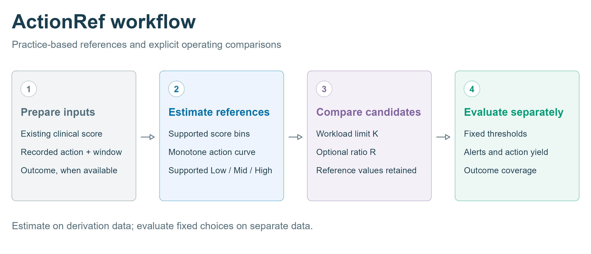
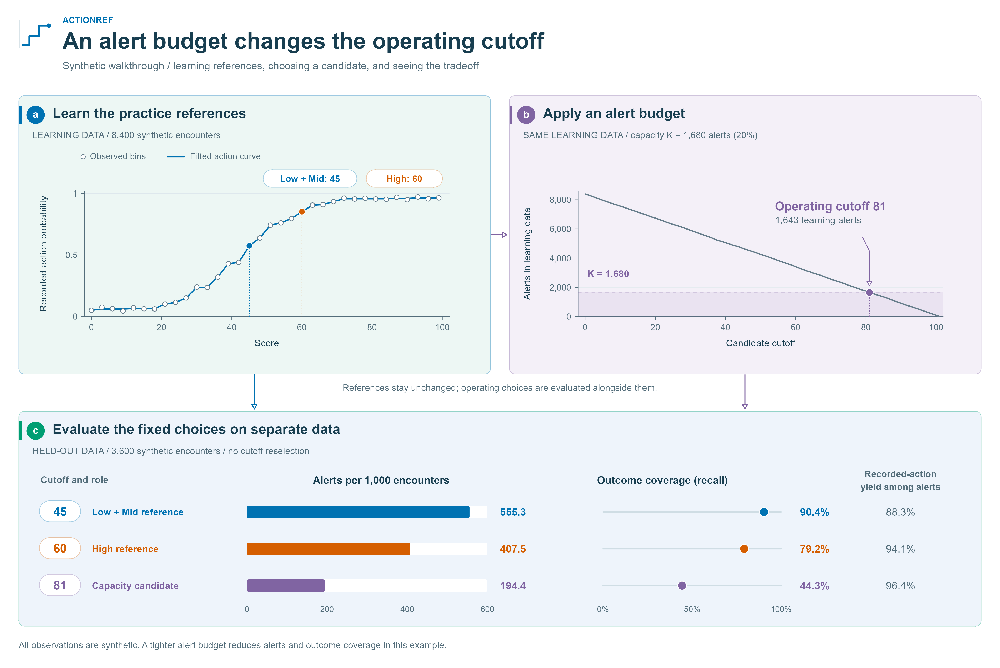

# ActionRef

**Connect clinical scores to observed practice, then make threshold trade-offs explicit.**

ActionRef estimates interpretable reference thresholds from the relationship between an
existing score and recorded clinical actions. Teams can use those references to
understand local practice, examine alert workload, and compare candidate thresholds
under a stated capacity or consequence scenario.

The Python package is `universal-cutoff`; the import is `universal_cutoff`.
[MIT license](LICENSE) ·
[Software release](https://github.com/Sheldon0106/ActionRef/releases/latest).

[Get started](docs/quickstart.md) · [Prepare your data](docs/data.md) ·
[Interpret references](docs/references.md) · [API](docs/API_REFERENCE.md) ·
[Clinical example](docs/clinical-example.md) · [Reproduce the paper](docs/paper-reproduction.md)



[Zoomable SVG](docs/assets/figures/workflow.svg) · [PDF](docs/assets/figures/workflow.pdf) ·
[Documentation illustration sources](docs/figures.md)

## What does ActionRef answer?

| Question | Output |
|---|---|
| How do recorded actions vary across a score? | An empirical action curve with sample support. |
| Which score values have interpretable behavioral meaning? | Low, Mid, and High references with their probability targets and provenance; only the supported levels when evidence is limited. |
| What fits a team's alert budget? | Capacity-adjusted operating candidates that retain the original references. |
| What changes if a candidate is used? | Alert burden, recorded-action yield, outcome coverage, and optional scenario-weighted loss. |

An action probability describes recorded practice. A disease risk describes an
outcome. ActionRef keeps those quantities separate. Capacity and consequence
analyses support a local decision; they do not turn recorded practice into a
treatment recommendation.

## Quick start

Clone the repository and install in a Python environment:

```bash
git clone https://github.com/Sheldon0106/ActionRef.git
cd ActionRef
python -m pip install -e ".[test]"
python examples/synthetic_walkthrough.py --output-dir output/synthetic
```

The example creates **12,000 synthetic encounters**, estimates references on 8,400,
and evaluates the same references and capacity candidates on the remaining 3,600.
It needs no clinical data or downloads after installation.

```text
Estimated references
Low     45    absolute
Mid     45    absolute
High    60    absolute
```

Low and Mid coincide in this example. They keep their different meanings while
sharing one operating threshold. A budget of 1,680 alerts in the derivation cohort
maps the available references to a candidate of 81. Internal validation alert burden is then
measured without refitting; the original budget is not a guarantee for a new cohort.

The script saves `references.csv`, `learning_curve.csv`, `capacity.csv`,
`heldout.csv`, and `summary.json`. See the [walkthrough](docs/quickstart.md) for
the code, output definitions, and missing-data rules.



## Use your own score

Supply one row per encounter and a numeric score whose higher values indicate
greater concern. Module 2 also needs a binary recorded-action label; outcome
labels are optional and enable outcome evaluation and consequence analysis.

```python
import pandas as pd
from universal_cutoff import fit_behavior_thresholds, evaluate_frozen_thresholds

learning = pd.read_csv("data/learning.csv")
evaluation = pd.read_csv("data/evaluation.csv")

references = fit_behavior_thresholds(learning, "score", "response")
print(references.anchors[["level", "selected_threshold", "provenance_tier"]])

# Evaluate only when at least one reference is available.
if references.anchors.selected_threshold.notna().any():
    report = evaluate_frozen_thresholds(
        evaluation, "score", references.anchors,
        response_col="response", outcome_col="outcome",
    )
    print(report.table)
```

Prepare separate learning and evaluation cohorts before calling these functions.
For repeated encounters, split by patient. Define the action components, their
observation windows, and missingness before interpreting the references.
[Data contract →](docs/data.md)

## Follow the workflow

1. **Check the score and inputs.** Review completeness, score orientation, and optional outcome performance.
2. **Estimate behavioral references.** Inspect the observed action curve, targets, and evidence support.
3. **Compare operating candidates.** Apply a capacity budget; add consequence scenarios when relevant.
4. **Evaluate on separate data.** Report workload, action yield, and outcome coverage for fixed thresholds.

The [clinical example](docs/clinical-example.md) illustrates the MIMIC sepsis
references 27 / 39 / 54 and a separate candidate-comparison question. These values
belong to that analysis; the software learns references for the supplied data.

## Manuscript results

The manuscript contains Tables 1–3, Figures 1–5, eTables 1–14 and eFigures 1–5.
The [result map](docs/evidence.md#manuscript-result-map) connects every display
item to public aggregates, analysis code and its reproduction scope.
[Extended results](results/supplement_extended/README.md) supply subgroup-level
diagnostics, the original eight-scenario simulation, conventional-rule selection
uncertainty, minimax regret and transfer-target sensitivity. The
[K/R guide](docs/R_GUIDANCE.md) accompanies these results.

<details>
<summary>Table and figure inputs</summary>

`S/` = `results/sepsis_primary/`, `W/` = `results/early_warning_scores/`,
`X/` = `results/supplement_extended/`. A filename following a directory entry
uses that same directory. **P** = `examples/reproduce_paper.py`,
**E** = `examples/reproduce_extended.py`, **A** = `examples/sepsis_paper_analysis.py`.
P and E use public aggregates. A requires authorized prepared clinical inputs.
Saved summaries retain the original estimation and resampling results; the table
identifies scientific inputs and analysis code, not journal artwork generation.

| Display item | Content | Aggregate inputs or definitions | Analysis entry point and scope |
|---|---|---|---|
| Table 1 | Cohort characteristics | S/cohort_characteristics.csv | Saved descriptive table; E checks action denominators |
| Table 2 | Reference thresholds and uncertainty | S/reference_bootstrap/reference_summary.csv; reference_point_anchors.csv | A estimates references; saved bootstrap summaries |
| Table 3 | References, revised threshold and comparators | S/operating_counts.csv; observed_action_yield.csv; conventional_rules/rule_operating_rows.csv; conventional_rules/esrp_tier_boundaries.csv | P + E: counts to operating rates |
| Figure 1 | Framework | docs/references.md; docs/operating-candidates.md; configs/sepsis_primary.json | A: analysis workflow; conceptual illustration |
| Figure 2 | Action curve and probability evaluation | S/semantic_response_curve.csv; sepsis_action_reliability.json; sepsis_action_points.json | A: curve/evaluation; P: saved probability summaries |
| Figure 3 | Workload and consequences of threshold revision | S/learning_fae_curve.csv; operating_counts.csv; operating_uncertainty/paired_FAE_difference.json | E: derivation curve count checks; P: fixed comparison; saved paired interval |
| Figure 4 | Role of R | S/learning_R_selection.csv; learning_R_invariance.csv; fixed_candidate_R_sensitivity.csv | P: derivation-grid selections and fixed-pair sensitivity |
| Figure 5 | Alerts and sepsis sensitivity across four scores | W/default/fixed_reference_operating_points.csv; S/operating_counts.csv | P --early-warning-scores: fixed-reference rates |
| eTable 1 | Default settings | src/universal_cutoff/config.py | src/universal_cutoff/module2.py |
| eTable 2 | Triage-score implementations | W/default/score_formula_definition.csv; score_component_implementation.csv | Saved score definitions; A accepts supplied ESRP inputs |
| eTable 3 | Score and action-probability performance | S/score_assessment/; S/sepsis_action_points.json; S/sepsis_action_intervals.json; S/logistic_comparison/ | P: saved action estimates; A: score/action evaluation; saved intervals |
| eTable 4 | Action components and component references | S/components/ | A: primary composite construction; saved component analyses |
| eTable 5 | Reference uncertainty | S/reference_bootstrap/; S/action_definition_sensitivity/reference_bootstrap_summary.csv | src/universal_cutoff/bootstrap.py; saved resampling summaries |
| eTable 6 | Conventional rules | S/conventional_rules/rule_operating_rows.csv; esrp_tier_boundaries.csv; comparator_contracts_extended.csv; S/learning_fae_curve.csv | E: operating/count checks; saved selection contracts |
| eTable 7 | References and revised threshold 34 | S/operating_counts.csv; observed_action_yield.csv; learning_fae_curve.csv; operating_uncertainty/ | P + E: count-based rates; saved operating intervals |
| eTable 8 | Consequence scenario and R sensitivity | configs/sepsis_r_scenario.yaml; S/fixed_candidate_R_sensitivity.csv; docs/R_GUIDANCE.md | P: fixed-pair calculation; src/universal_cutoff/r_guidance.py |
| eTable 9 | Action definitions and windows | S/action_definition_sensitivity/ | src/universal_cutoff/module2.py; saved window-specific analyses |
| eTable 10 | Support criteria and targets | S/reference_sensitivity/ | src/universal_cutoff/module2.py; saved parameter sensitivity summaries |
| eTable 11 | External and era-based reference assessment | S/reference_bootstrap/; S/era_and_transport/v7_cell56_temporal_drift.csv; S/era_and_transport/v7_cell56_temporal_operating.csv | A: fixed transport and local estimation; saved era summaries |
| eTable 12 | Subgroup diagnostics | S/subgroups/; X/subgroup_diagnostics.csv | E: join saved subgroup operating/calibration results |
| eTable 13 | Early warning scores | W/default/; W/qsofa_short_scale/ | P --early-warning-scores; saved reference/short-scale summaries |
| eTable 14 | Paired support-criteria simulation | simulations/support_gate/condition_error_summary.csv; config.json | simulations/support_gate/runner.py (seed 2026101101); saved results |
| eFigure 1 | Weighted loss and net benefit | S/learning_fae_curve.csv; operating_counts.csv; fixed_candidate_R_sensitivity.csv | P + E: loss arithmetic; net benefit = TP/N - FP/(R*N) |
| eFigure 2 | Uniform windows and action components | S/action_definition_sensitivity/corrected_action_window_thresholds.csv; S/components/threshold_action_workload_matrix.csv | Saved window-specific references and component counts |
| eFigure 3 | Local references by MIMIC era | S/era_and_transport/v7_cell56_temporal_drift.csv | Saved era estimates; src/universal_cutoff/module2.py |
| eFigure 4 | Subgroup sensitivity ranges | S/subgroups/v7_subgroup_paper_summary_reconstructed.csv; X/subgroup_diagnostics.csv | E: saved subgroup operating values; sensitivity = TP/(TP+FN) |
| eFigure 5 | Early warning action curves and references | W/default/action_curves.csv; reference_point_anchors.csv; W/qsofa_short_scale/action_curves.csv; reference_point_anchors.csv | Saved curves/reference outputs; src/universal_cutoff/module2.py |

</details>

## Documentation and repository

The manuscript examines **emergency sepsis assessment**. ESRP is the primary
score: MIMIC references are 27 / 39 / 54, Stanford local references are
26 / 36 / 50, and revised threshold 34 uses R = 11,299/804. The same recorded-action
analysis also evaluates NEWS2, MEWS, REMS and qSOFA. See the
[sepsis aggregate results](docs/paper-results.md).

COPD, HEART-derived AERT, pneumonia and AKI materials are retained as
**exploratory, not reported in the manuscript**. Changepoint functionality is
retained for exploratory use and was not used in the manuscript. The
[evidence guide](docs/evidence.md) distinguishes manuscript materials from these
development records.

Two routes through the repository:

- **Use ActionRef on your data:** follow the [synthetic walkthrough](docs/quickstart.md),
  [data contract](docs/data.md), and [output-state examples](docs/output-states.md).
- **Examine the paper evidence:** follow the [reproduction guide](docs/paper-reproduction.md)
  and [sepsis aggregate results](docs/paper-results.md). Shared counts allow
  recalculation of operating rates and fixed-threshold loss comparisons. Some
  uncertainty intervals are read from saved summaries; the aggregate entry point
  does not re-estimate them. Clinical analyses require authorized source data.

```bash
python examples/reproduce_paper.py --early-warning-scores
python examples/reproduce_extended.py
```

The documentation is built with MkDocs Material and includes a workflow overview,
tutorials, clinical examples, and API guidance.
The documentation illustrations are drawn in R/grid from vector artwork
and saved aggregate inputs. Manuscript figure data are
listed in the [figure guide](docs/figures.md). [Build the documentation illustrations](docs/figures.md) or edit their
[R sources](scripts/figures/).

```bash
python -m pip install -r requirements-docs.txt
python -m mkdocs serve
```

| Location | Contents |
|---|---|
| [`src/universal_cutoff/`](src/universal_cutoff/) | Package APIs and method implementation |
| [`examples/`](examples/) | Synthetic walkthrough and clinical-data runners |
| [`simulations/`](simulations/README.md) | Existing simulation runners, configurations, seeds and saved condition-level error summaries |
| [`docs/`](docs/index.md) | Tutorials, interpretation, API, and analysis notes |
| [`configs/`](configs/) | Declared disease and analysis configurations |
| [`results/`](results/) | Aggregate research outputs; see the [evidence guide](docs/evidence.md) for analysis roles |
| [`scripts/`](scripts/) | Figure generation and public-repository checks |
| [`tests/`](tests/) | Synthetic tests of software behavior |

## Reproducibility, data, and citation

The core package supports Python 3.8 and newer. Documentation tooling uses Python
3.11 or newer. Run `python -m pytest` for the software tests; see
[Contributing](CONTRIBUTING.md) for the full build and documentation checks.

Clinical encounter data are not distributed here. Public examples use synthetic
data, and research artifacts contain aggregate outputs. The package supports
retrospective analysis and local evaluation; clinical deployment requires evaluation
of the proposed workflow in its intended setting.

For software citation, record the repository URL, package version, and commit used.
[CITATION.cff](CITATION.cff) provides the software citation metadata.
