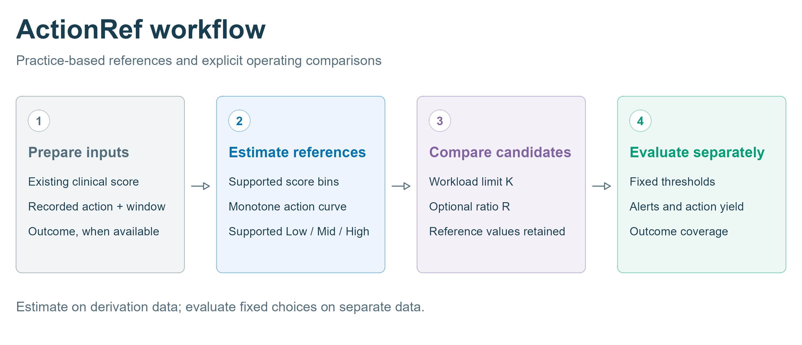
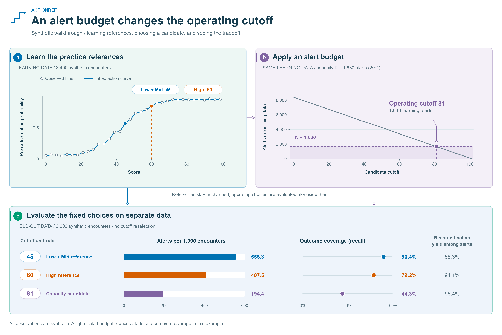

# Documentation illustrations

The repository's workflow illustration and synthetic walkthrough explain how to
use ActionRef. Their R/grid sources are in `scripts/figures/`, with the common
builder at `scripts/build_figures.R`.

## Workflow illustration



The illustration connects score assessment, recorded-action references, capacity
and consequence inputs, and evaluation on separate data. Its clinical inset uses
saved aggregate inputs; it does not refit a model.

[SVG](assets/figures/workflow.svg) · [PDF](assets/figures/workflow.pdf)

## Synthetic walkthrough



This tutorial uses `examples/synthetic_walkthrough.py`, seed 719 and split seed
2026. Its saved inputs are in `docs/assets/data/synthetic_*`.

[SVG](assets/figures/synthetic-example.svg) · [PDF](assets/figures/synthetic-example.pdf)

## Build the documentation artwork

With R 4.4 or newer, run from the repository root:

```bash
Rscript -e "install.packages(c('jsonlite', 'svglite', 'ragg'), repos='https://cloud.r-project.org')"
Rscript scripts/build_figures.R
```

Exports are SVG, PDF and 300-dpi PNG. The builder reads the committed aggregate
inputs and writes inspection outputs to ignored `output/figures/`. The shared
colors are defined in `configs/figure_palette.json`.
