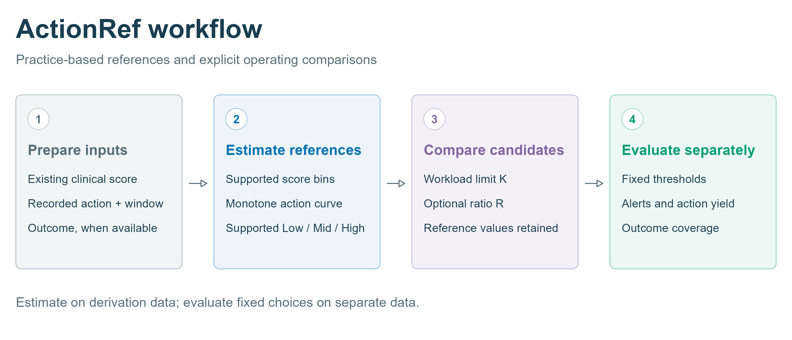

# ActionRef

ActionRef estimates practice-based reference thresholds for existing clinical
scores and supports comparisons under workload and consequence assumptions.
The input is a score paired with recorded actions; the output is an estimated
action curve, supported reference thresholds, and operating summaries.

Start with the [synthetic walkthrough](quickstart.md), then prepare
[your own data](data.md). The [method guide](references.md) explains reference
estimation and output states. Use the [K/R guide](R_GUIDANCE.md) to specify
workload and consequence assumptions, and the [API reference](API_REFERENCE.md)
for function details.

The study evaluates ESRP, NEWS2, MEWS, REMS and qSOFA in emergency sepsis
assessment. [Study materials](paper-reproduction.md) describes its analysis
scripts, simulations, aggregate results and data access.

The Python distribution is `universal-cutoff`; the import is `universal_cutoff`.
Source code is available on [GitHub](https://github.com/Sheldon0106/ActionRef)
under the MIT license.
